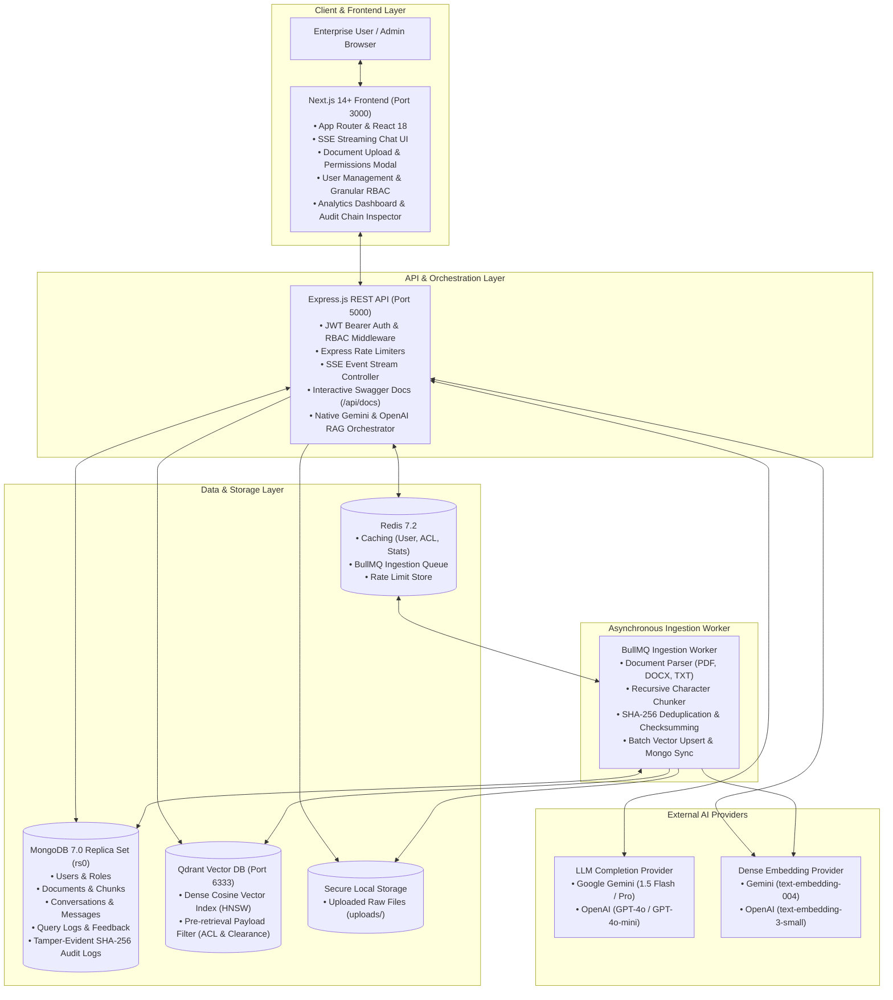

# Enterprise AI Knowledge & Support Copilot

An enterprise-grade, multi-tenant AI copilot powered by Retrieval-Augmented Generation (RAG), strict document-level Access Control Lists (ACLs), role-based security clearances, asynchronous document ingestion, and real-time Server-Sent Events (SSE) streaming.

---

## Architecture Diagram

The diagram below illustrates the actual end-to-end system architecture, service boundaries, data flows, and external provider integrations:



---

## Technical Documentation Suite

Comprehensive architecture, design, failure handling, and scalability specifications:

- **[OpenAPI / Swagger Documentation](http://localhost:5000/api/docs)**: Live interactive API reference mounted at `/api/docs` (Raw JSON at `/api/docs/openapi.json`), documenting all 31 REST endpoints, request/response schemas, JWT bearer authorization, and pagination.
- **[Database Design Guide](docs/database-design.md)**: Exhaustive schema documentation for all 9 Mongoose models, compound indexes, reference graphs, security fields, and offset vs. cursor pagination strategies.
- **[Failure-Handling & Resilience Architecture](docs/failure-handling.md)**: Detailed failure modes, timeouts, retries, idempotency, user impact, and circuit-breaker designs across LLM, Qdrant, MongoDB, Redis, and worker subsystems.
- **[Scalability & Performance Guide](docs/scalability-performance.md)**: Horizontal scaling plans, stateless auth, Redis cache invalidation, BullMQ concurrency, Qdrant HNSW tuning, and phased capacity planning from 10,000 to 500,000 req/day.
- **[Environment & Setup Guide](docs/setup-guide.md)**: Configuration template, secret generation, and environment variable requirements.
- **[Security Corrections & Empty-ACL Semantics](docs/architecture/corrections.md)**: Security documentation detailing organization-wide access semantics for unconstrained ACL documents.
- **AI & LLM Architecture**: Direct integration via native `@google/genai` (v2.30.0) and `openai` (v7.39.0) SDKs through dedicated TypeScript service adapters (`RagService`, `GeminiLlmService`, `OpenAiLlmService`, `FallbackLlmService`), providing deterministic retry logic, token telemetry, and automated fallback failover without runtime overhead from third-party framework wrappers.

---

## Sample Knowledge Documents

A suite of synthetic, non-sensitive sample documents is located in [`samples/`](samples/) for immediate testing of multi-format document ingestion, chunking, and RAG query answering:

| Sample Document | Format | Description | Target Ingestion Topics |
| :--- | :--- | :--- | :--- |
| [`HR_Work_From_Home_Policy.pdf`](samples/HR_Work_From_Home_Policy.pdf) | PDF | Synthetic corporate remote-work policy | Eligibility, core hours (10 AM - 4 PM EST), home office stipends, ergonomic reviews |
| [`IT_Hardware_and_Security_Guide.docx`](samples/IT_Hardware_and_Security_Guide.docx) | DOCX (OpenXML) | Synthetic IT security & equipment guide | Standard issue laptops, FileVault/BitLocker encryption, 16-char passphrases, VPN protocols |
| [`Corporate_Data_Retention_Policy.txt`](samples/Corporate_Data_Retention_Policy.txt) | Plain Text | Synthetic record retention schedule | Financial audits (7 years), personnel logs (5 years), audit trails (1 year hot), legal holds |

For details on the synthetic data inventory and programmatic generator, see [`samples/README.md`](samples/README.md).

---

## Project Structure

```
enterprise-ai/
├── apps/
│   ├── backend/               # Express REST API, Native Gemini/OpenAI RAG & BullMQ worker
│   │   ├── src/
│   │   │   ├── docs/          # OpenAPI 3.0 specification & Swagger setup
│   │   │   ├── controllers/   # Route handlers
│   │   │   ├── models/        # Mongoose data models
│   │   │   ├── routes/        # Express route modules
│   │   │   ├── services/      # RAG, Ingestion, Auth, Audit, & Analytics services
│   │   │   └── workers/       # BullMQ ingestion worker
│   │   └── tests/             # Unit and integration test suites
│   └── frontend/              # Next.js 14 App Router UI
│       └── src/
│           ├── app/           # Next.js App Router pages
│           ├── components/    # UI components (Chat, Upload, Analytics, Audit)
│           └── lib/           # API clients and auth context
├── packages/
│   └── shared-types/          # Shared TypeScript contracts & DTOs
├── infrastructure/
│   └── docker-compose.infra.yml # MongoDB rs0, Redis, and Qdrant containers
├── docs/                      # Core architectural & technical documentation
├── samples/                   # Synthetic knowledge documents (PDF, DOCX, TXT)
├── .env.example               # Master environment variable template
├── package.json               # Root workspace manifest
└── tsconfig.base.json         # Strict TypeScript configuration
```

---

## Full-Stack Docker Containerization (Local Demo)

The complete Enterprise AI Copilot stack can be run locally using Docker Compose, orchestrating the Next.js frontend, Express API backend, asynchronous BullMQ worker, MongoDB replica set (`rs0`), Redis cache/queue, and Qdrant vector database.

### 1. Prerequisites
- [Docker Desktop](https://www.docker.com/products/docker-desktop/) with Docker Compose v2+ installed and running.
- At least 4 GB of RAM allocated to Docker.
- Port availability on the host machine:
  - `3000`: Next.js Frontend
  - `5000`: Express API Backend
  - `27017`: MongoDB Replica Set
  - `6379`: Redis Cache & Queue
  - `6333`: Qdrant REST API
  - `6334`: Qdrant gRPC

### 2. Environment Configuration
Copy the master environment template:
```powershell
Copy-Item .env.example .env
```
Docker Compose provides safe, out-of-the-box demo defaults for internal service hostnames and 256-bit cryptographic keys (`JWT_ACCESS_SECRET`, `JWT_REFRESH_SECRET`, `AUDIT_LOG_HMAC_SECRET`). You can override any variable by setting it in `.env`.

### 3. AI Provider Key Setup
To enable document indexing embeddings and LLM answer generation:
1. Open `.env` in your editor.
2. Set your active provider and API key:
   ```bash
   LLM_PROVIDER=gemini
   GEMINI_API_KEY=your_gemini_api_key_here
   ```
   Or for OpenAI:
   ```bash
   LLM_PROVIDER=openai
   OPENAI_API_KEY=your_openai_api_key_here
   ```
> **Security Note:** Never commit your `.env` file or bake API keys into Docker images. `.dockerignore` automatically excludes `.env` and sensitive files from container builds.

### 4. Start the Full Stack
Build the multi-stage application images and launch all services in detached mode:
```powershell
# Using Docker Compose directly
docker compose up -d --build

# Or using the root package shortcut
npm.cmd run docker:up
```

### 5. Inspect Service Health & Logs
Check container status and health checks:
```powershell
docker compose ps
# Or: npm.cmd run docker:status
```
All services (`mongodb`, `redis`, `qdrant`, `backend`, `worker`, `frontend`) should display `Up` with `(healthy)`.

Inspect real-time logs:
```powershell
# Follow logs for all services
docker compose logs -f

# Follow logs for a specific service
docker compose logs -f backend
docker compose logs -f worker
docker compose logs -f frontend
```

### 6. Application Access URLs
- **Web UI (Frontend)**: [http://localhost:3000](http://localhost:3000)
- **REST API Base**: [http://localhost:5000/api/v1](http://localhost:5000/api/v1)
- **Backend Readiness Healthcheck**: [http://localhost:5000/health/readiness](http://localhost:5000/health/readiness)
- **Backend Liveness Healthcheck**: [http://localhost:5000/health/liveness](http://localhost:5000/health/liveness)
- **Interactive Swagger / OpenAPI Docs**: [http://localhost:5000/api/docs](http://localhost:5000/api/docs)
- **Qdrant Vector DB REST API**: [http://localhost:6333/dashboard](http://localhost:6333/dashboard)

### 7. MongoDB Replica Set Initialization
MongoDB requires a replica set (`rs0`) to support multi-document ACID transactions used by authentication, ACLs, and conversation models. The `mongo-init-replica` ephemeral container runs on startup to initiate `rs0` idempotently. The backend and worker containers automatically wait for this step to complete before connecting.

### 8. Stopping Services
Stop and remove containers while preserving persistent volume data:
```powershell
docker compose down
# Or: npm.cmd run docker:down
```

To stop containers and **wipe all persistent database and vector data**:
```powershell
docker compose down -v
```

### 9. Persistent Storage Volumes
The demo configuration uses four named Docker volumes to persist state across restarts:
- `mongo_data`: Persists MongoDB user records, documents, chunk metadata, conversation histories, and HMAC audit chains (`/data/db`).
- `redis_data`: Persists Redis append-only file (AOF) state, rate limit counters, and queue state (`/data`).
- `qdrant_data`: Persists Qdrant vector embeddings, HNSW graphs, and payload indexes (`/qdrant/storage`).
- `upload_data`: Shared volume between `backend` and `worker` containers storing uploaded raw documents (`/app/data/uploads`).

### 10. Troubleshooting
- **Backend fails healthcheck on startup**:
  - Check `docker compose logs backend`. Verify that MongoDB replica set is initialized and that Qdrant and Redis report healthy.
- **Worker fails or crashes**:
  - Check `docker compose logs worker`. Verify Redis is healthy on port `6379` and that `/app/data/uploads` has write permissions.
- **RAG answers return provider error or fallback message**:
  - Check `docker compose logs -f backend`. Ensure `GEMINI_API_KEY` or `OPENAI_API_KEY` is provided in `.env` and that your API quota is active.
- **Frontend fails to reach backend**:
  - Ensure backend container is healthy on port `5000`. By default, the browser accesses the backend via `http://localhost:5000/api/v1`. If running on a remote host, configure `NEXT_PUBLIC_API_URL` during build.

### 11. Local Demo Limitations
- Single-node MongoDB replica set is designed for local development and demonstration; multi-node clustering with election arbiters is required for production fault tolerance.
- Internal container networking uses unencrypted HTTP/TCP within the bridge network (`enterprise_ai_net`).
- Development secrets are supplied as fallback defaults for demo convenience; production deployments must supply cryptographically random secrets from a secret manager (e.g. AWS Secrets Manager or HashiCorp Vault).

---

## Local Development Quickstart

### Prerequisites
- Node.js `v20+` (Verified: `v24.21.0`)
- npm `v10+` (Verified: `11.19.0`)
- Docker Desktop with Docker Compose (Verified: Docker Engine `29.8.2`, Compose `v5.5.1`)

### 1. Install Workspace Dependencies
On Windows, run npm commands via `cmd /c npm` or `npm.cmd`:
```powershell
cmd /c npm ci
```

### 2. Build Shared Types
Build shared contracts before typechecking or running dependent workspaces:
```powershell
cmd /c npm run build:packages
```

### 3. Start Local Infrastructure
Start MongoDB (with replica set `rs0`), Redis, and Qdrant in Docker:
```powershell
cmd /c npm run infra:up
```

Verify service status:
```powershell
cmd /c npm run infra:status
```

### 4. Configure Environment Variables
Copy `.env.example` to `.env` and configure your local settings. Follow the detailed instructions in [docs/setup-guide.md](docs/setup-guide.md).
```powershell
Copy-Item .env.example .env
```

### 5. Running the Application Locally
Run the backend API and frontend development servers:

```powershell
# Terminal 1: Start Express API (and background ingestion worker)
npm.cmd run dev --workspace=@enterprise-ai/backend

# Terminal 2: Start Next.js Frontend
npm.cmd run dev --workspace=@enterprise-ai/frontend
```

Once running:
- **Web UI**: Navigate to `http://localhost:3000`
- **Swagger / OpenAPI Documentation**: Navigate to `http://localhost:5000/api/docs`
- **Raw OpenAPI Spec**: `http://localhost:5000/api/docs/openapi.json`

### 6. Workspace Typecheck, Lint & Test
Run complete verification across all workspaces:
```powershell
# Typecheck all workspaces (builds shared types first)
npm.cmd run typecheck

# Lint all workspaces
npm.cmd run lint

# Run backend unit tests (pure in-memory tests)
node ../../node_modules/jest/bin/jest.js --config apps/backend/jest.config.unit.cjs --testMatch="<rootDir>/tests/swagger.test.ts"

# Run frontend tests
npm.cmd test --workspace=@enterprise-ai/frontend

# Run production build validation
npm.cmd run build
```

---

## License
Proprietary & Confidential — Enterprise AI Copilot Project.
