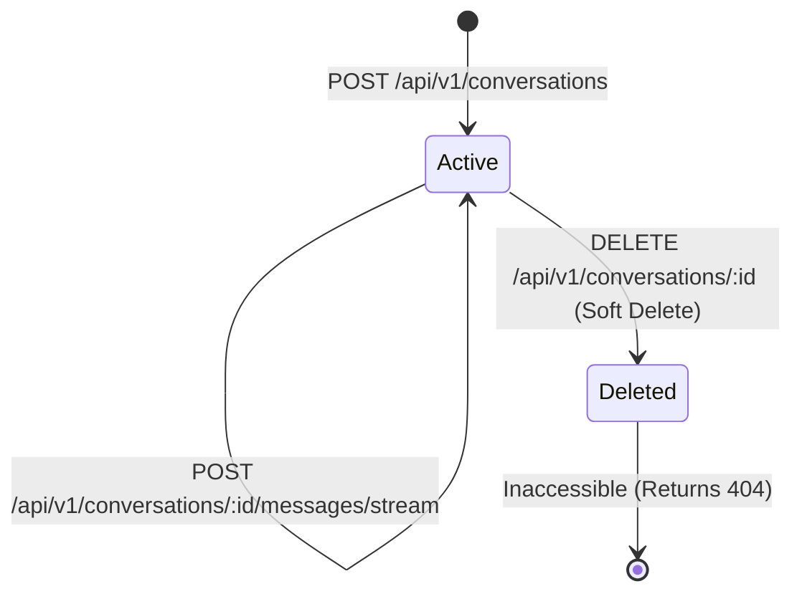
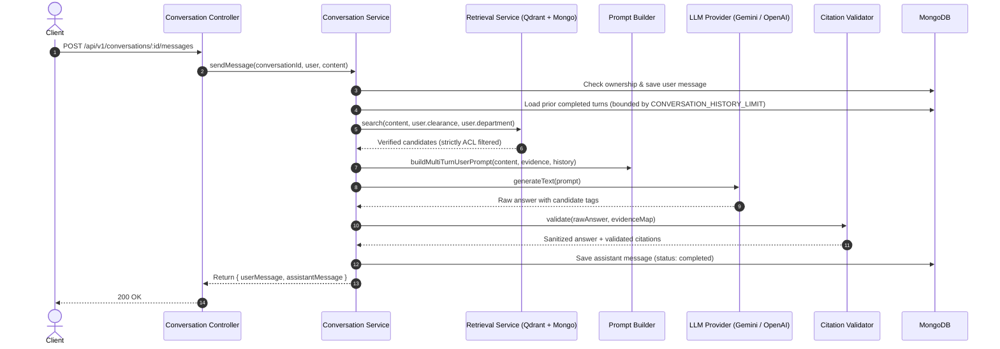

# Phase 5 — Conversational Chat, SSE Streaming, Multi-Turn History, Redis Caching & Rate Limiting

## 1. Architectural Overview & Context

Phase 5 introduces enterprise-grade conversational capabilities to the Enterprise AI Knowledge & Support Copilot. It extends the Phase 4 Retrieval-Augmented Generation (RAG) system with stateful multi-turn conversations, secure Server-Sent Events (SSE) streaming, authorization-aware Redis response caching, and atomic Redis-backed sliding-window rate limiting.

### Core Architectural Principles:
1. **Local-First & Multi-Tenant Isolation**: Conversations and messages are strictly partitioned by authenticated user identity (`userId`). Cross-user conversation reads, message posts, streaming sessions, or deletions return `404 Not Found` (anti-enumeration policy).
2. **Dynamic Turn-by-Turn Authorization Reevaluation**: A conversation is **never** a permanent authorization grant. Every single conversational turn re-evaluates the authenticated principal's active roles, department, and security clearance against Qdrant vector ACLs and MongoDB active revisions. Historical citations or previous answers can never authorize document access.
3. **Citation-Safe Streaming**: Model answer text is **never** released as speculative or unvalidated intermediate token fragments. Server-side token generation is buffered internally; the `CitationValidator` runs against the complete answer text and authorized evidence map. Answer content is released as `message.delta` events only after citation verification succeeds. If grounding fails, the canonical insufficient-evidence answer is emitted with empty citations.
4. **Authorization-Aware Response Caching**: Redis cache keys incorporate a cryptographic fingerprint of the query, user ID, department, security clearance, and role. Invalidation is instantaneous ($O(1)$) across the entire cluster using a generation counter (`rag:cache:generation`) incremented whenever documents are uploaded, retried, deleted, or revised.
5. **Atomic Sliding-Window Rate Limiting**: Per-user and per-endpoint quotas are evaluated atomically in Redis via an atomic Lua script, preventing concurrency race condition bypasses. In production, rate limiting fails closed (`503 Service Unavailable`) if Redis becomes unavailable.

---

## 2. Conversation Lifecycle & Ownership Model

Conversations are managed in the `ConversationModel` collection and message turns in `MessageModel`.



### Ownership Enforcement
- **Principal Derivation**: `userId` is strictly extracted from the validated server-side JWT token (`req.user.sub`). Any `userId` supplied in the client request body is discarded.
- **Access Boundary**: Every operation (`GET /:id`, `GET /:id/messages`, `POST /:id/messages`, `POST /:id/messages/stream`, `DELETE /:id`) executes `ConversationService.getConversationById(conversationId, user)`.
- **Anti-Enumeration 404 Policy**: If the requested conversation does not exist, belongs to another user, or has `status: 'deleted'`, the server returns `404 Not Found` rather than `403 Forbidden`, preventing attackers from enumerating valid conversation IDs.
- **Admin Isolation**: Administrators cannot inspect or mutate user conversations unless an explicit organizational compliance role or audit route is invoked.

---

## 3. Message Persistence & Idempotency Behavior

### Message Schema & Status Transitions
The `MessageModel` represents dialogue turns:
- `conversationId`: Reference to parent `Conversation`.
- `sender`: `'user' | 'assistant' | 'system'`.
- `content`: Bounded text content (up to `CONVERSATION_MESSAGE_MAX_CHARS = 4000`).
- `status`: `'pending' | 'completed' | 'failed' | 'cancelled'`.
- `citations`: Stored validated evidence references (`chunkId`, `documentId`, `title`, `source`, `evidenceId`, `revision`, `page`, `snippet`, `relevanceScore`).
- `idempotencyKey`: Optional client UUID indexed sparsely (`{ conversationId: 1, idempotencyKey: 1 }`).
- `requestId`: Correlation ID for distributed tracing.
- `tokensUsed`: Telemetry (`promptTokens`, `completionTokens`, `totalTokens`).
- `latencyMs`: Total turn latency in milliseconds.

### Idempotency Strategy
When a client sends `idempotencyKey`:
1. The server queries for an existing `user` message with `{ conversationId, idempotencyKey }`.
2. If found, it fetches the immediately following `assistant` response.
3. The existing pair is returned immediately without re-executing retrieval or calling external LLM providers, preventing duplicate billing and database duplication.

---

## 4. Multi-Turn Context & Dynamic Authorization Reevaluation



### Turn-by-Turn Reevaluation Rules:
1. **Bounded History Window**: Only the most recent `CONVERSATION_HISTORY_LIMIT` (default 10) messages are loaded. They are sorted in deterministic chronological order.
2. **Filtering Incomplete Turns**: Messages with status `'failed'`, `'cancelled'`, or `'pending'` are excluded from history to prevent polluting conversational context with hallucinated or aborted tokens.
3. **Prompt Segregation**: Historical dialogue is enclosed within `--- BEGIN PRIOR CONVERSATION HISTORY (UNTRUSTED DIALOGUE) ---`. Evidence is strictly segregated in `--- BEGIN VERIFIED EVIDENCE CONTEXT (UNTRUSTED DATA) ---`.
4. **No Authorization Inheritance**: If access to a document was revoked or a document revision changed between Turn 1 and Turn 2:
   - Turn 2 vector retrieval runs with the user's current JWT clearance and department.
   - Revoked documents will NOT appear in the candidates list.
   - If no candidates remain, the assistant outputs: *"I do not have sufficient information in the provided documentation to answer this question."*
   - Historical citations cannot authorize retrieval.

---

## 5. Server-Sent Events (SSE) Streaming Protocol

Endpoint: `POST /api/v1/conversations/:conversationId/messages/stream`

### Transport Headers
```http
Content-Type: text/event-stream; charset=utf-8
Cache-Control: no-cache, no-transform
Connection: keep-alive
X-Accel-Buffering: no
```

### Event Sequence & Schemas

| Event Type | Timing / Condition | Payload Schema |
| :--- | :--- | :--- |
| `message.started` | Sent immediately after user message persistence and headers flushed | `{"conversationId": string, "messageId": string}` |
| `message.progress` | Emitted during processing stages (`retrieving`, `generating`, `validating`) | `{"stage": "retrieving"\|"generating"\|"validating", "progress": number}` |
| `: heartbeat` | Comment ping emitted every `SSE_HEARTBEAT_INTERVAL_MS` (15s) | N/A (SSE comment format `: heartbeat\n\n`) |
| `message.delta` | Emitted in chunks **only after complete generation and citation validation** | `{"content": string}` |
| `message.citations` | Emitted after all delta text has been released | `{"citations": ICitation[]}` |
| `message.completed` | Emitted after assistant message is persisted to MongoDB | `{"messageId": string, "tokensUsed": {...}, "latencyMs": number, "modelProvider": string, "modelName": string}` |
| `message.error` | Emitted if an error occurs after response headers have been sent | `{"code": string, "message": string}` |

### Disconnect and Cancellation Handling
- Express `req.on('close')` triggers an `AbortController.abort()` to terminate provider generation.
- The heartbeat interval timer is cleared in a `finally` block.
- If the client disconnects before citation validation, incomplete output is discarded and never saved as a completed assistant turn.
- If the client disconnects after the assistant response has been persisted, the completed response remains safely stored in MongoDB and can be retrieved via `GET /api/v1/conversations/:id/messages`.

---

## 6. Authorization-Aware Redis Response Caching

### Cache Key Architecture
Cache keys combine versioning, cluster generation counters, and cryptographic authorization fingerprints:
```
rag:cache:v1:gen:<generation>:<SHA256(fingerprint)>
```

The fingerprint contains:
```
u:<userId>|clr:<securityClearance>|dept:<department>|role:<role>|m:<modelName>|k:<topK>|th:<threshold>|q:<normalizedQuery>
```

### Security & Isolation Guarantees
1. **User Isolation**: Because `user.sub` is part of the fingerprint, User A cannot hit a private answer generated for User B.
2. **Clearance Isolation**: Users with `INTERNAL` clearance have distinct cache keys from users with `CONFIDENTIAL` or `RESTRICTED` clearance.
3. **Department Isolation**: Two users in different departments generate different keys, preventing departmental document leaks.
4. **Cluster-Wide Invalidation ($O(1)$)**:
   - Redis counter: `rag:cache:generation` (starts at 1).
   - Whenever any document is uploaded, retried, deleted, or its revision is activated in `ingestion.worker.ts`, `RagCacheService.invalidateAll()` is invoked.
   - This atomically sets or increments `rag:cache:generation`.
   - All previous cache entries immediately become cache misses without executing slow, blocking `KEYS *` or `FLUSHDB` commands.
5. **TTL & Payload Bounds**:
   - TTL: `RAG_CACHE_TTL_SECONDS = 3600` (1 hour).
   - Maximum Payload: `RAG_CACHE_MAX_PAYLOAD_BYTES = 131072` (128 KB). Oversized entries are rejected.
6. **Fail-Safe Policy**: If Redis is offline, cache reads return `null` and operations continue to authorized vector retrieval without failing or falling back to unfiltered search.

---

## 7. Redis-Backed Sliding-Window Rate Limiting

### Algorithm
Rate limiting is implemented using an atomic Redis Sorted Set (ZSET) sliding-window Lua script:
1. `ZREMRANGEBYSCORE key -inf (now - windowMs)` removes timestamps older than the sliding window.
2. `ZCARD key` evaluates current requests in the active window.
3. If `currentCount < maxRequests`:
   - Adds member `now:uuid` with score `now`.
   - Refreshes TTL via `PEXPIRE key windowMs`.
   - Returns `{1, remaining, resetSeconds}`.
4. If limit exceeded:
   - Computes reset interval from the oldest element score.
   - Returns `{0, 0, resetSeconds}`.

### Rate Limit Endpoints & Defaults
| Category | Protected Endpoints | Window | Max Requests |
| :--- | :--- | :--- | :--- |
| `chat` | `POST .../messages`, `POST .../messages/stream` | 60,000 ms (1 min) | 20 |
| `rag` | `POST /api/v1/rag/query` | 60,000 ms (1 min) | 20 |
| `conversation_create`| `POST /api/v1/conversations` | 900,000 ms (15 min)| 30 |
| `conversation_list` | `GET /api/v1/conversations` | 900,000 ms (15 min)| 60 |
| `history` | `GET /api/v1/conversations/:id/messages` | 900,000 ms (15 min)| 60 |
| Standard API | All other routes | 900,000 ms (15 min)| 100 |

### Response Headers
When allowed:
- `X-RateLimit-Limit`: Maximum requests configured for window.
- `X-RateLimit-Remaining`: Remaining request allowance.
- `X-RateLimit-Reset`: Seconds until window reset.

When exceeded:
- HTTP Status: `429 Too Many Requests`
- Headers: `Retry-After: <seconds>`
- Payload: `{"success": false, "error": {"code": "TOO_MANY_REQUESTS", "message": "Rate limit exceeded. Please try again later.", "retryAfter": <seconds>}}`

### Production Fail-Closed Policy
In production (`NODE_ENV === 'production'`), if Redis becomes unreachable, the rate limiter fails closed for expensive endpoints, returning `503 Service Unavailable` (`SERVICE_UNAVAILABLE`). In development and test modes, a graceful warning bypass is permitted.

---

## 8. Configuration Reference

| Environment Variable | Type | Default | Description |
| :--- | :--- | :--- | :--- |
| `CONVERSATION_HISTORY_LIMIT` | number | `10` | Maximum prior messages included in multi-turn context |
| `CONVERSATION_MESSAGE_MAX_CHARS` | number | `4000` | Maximum character length for a single user message |
| `RAG_CACHE_ENABLED` | boolean | `true` | Enables authorization-aware Redis response caching |
| `RAG_CACHE_TTL_SECONDS` | number | `3600` | Time-to-live for cached RAG responses (in seconds) |
| `RAG_CACHE_MAX_PAYLOAD_BYTES` | number | `131072` | Maximum serialized cache entry size in bytes (128 KB) |
| `RATE_LIMIT_ENABLED` | boolean | `true` | Enables Redis sliding-window rate limiting |
| `RATE_LIMIT_WINDOW_MS` | number | `900000` | Default rate limit window in milliseconds (15 mins) |
| `RATE_LIMIT_MAX_REQUESTS` | number | `100` | Default maximum requests allowed per window |
| `RATE_LIMIT_CHAT_WINDOW_MS` | number | `60000` | Rate limit window for chat and streaming (1 min) |
| `RATE_LIMIT_CHAT_MAX_REQUESTS` | number | `20` | Max chat / stream requests per window per user |
| `RATE_LIMIT_CONVERSATION_MAX_REQUESTS` | number | `30` | Max conversation creations per window per user |
| `RATE_LIMIT_HISTORY_MAX_REQUESTS` | number | `60` | Max history / list requests per window per user |
| `SSE_HEARTBEAT_INTERVAL_MS` | number | `15000` | Interval for SSE heartbeat comment events |
| `REDIS_OPERATION_TIMEOUT_MS` | number | `3000` | Bound timeout for atomic Redis commands |

---

## 9. Known Limitations & Operational Considerations

1. **Process-Local Audit Chain Mutex**: The HMAC audit log chain uses a process-local write lock (`apps/backend/src/services/audit.service.ts`). In a multi-instance backend cluster, distributed audit sequence ordering requires a Redis distributed lock (e.g., Redlock) to prevent sequence number race conditions across node instances.
2. **Buffer-Safe SSE vs. Apparent Token Latency**: By enterprise security policy, model tokens are never streamed before citation validation. Progress events provide user feedback during the 1-2 second generation window, and validated text is released immediately upon completion.
