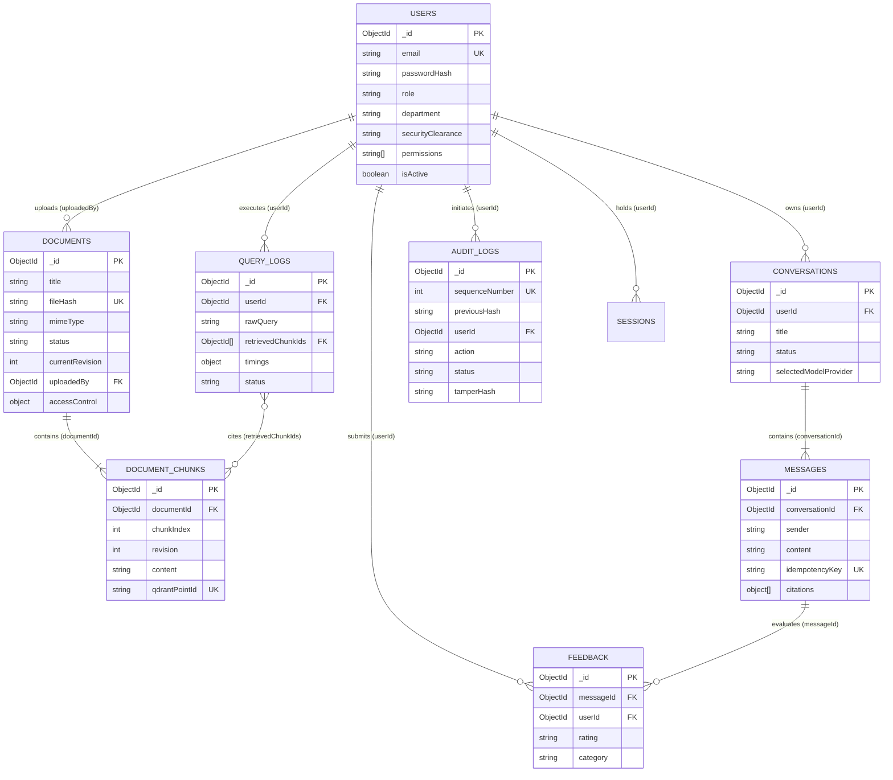

# Enterprise AI Knowledge & Support Copilot — Database Architecture & Data Dictionary

> **Document Type:** Production Database Design Specification  
> **Target Storage Engine:** MongoDB 7.0+ (Single-node or Distributed Replica Set `rs0` with WiredTiger)  
> **ORM / ODM:** Mongoose 8.9+  
> **Location:** `docs/database-design.md`

---

## 1. Architectural Overview & Design Principles

The database layer serves as the system of record for identity, document lifecycle states, conversational history, administrative feedback, and tamper-evident audit trails. Dense vector embeddings and semantic similarity computations are offloaded to **Qdrant**, keeping MongoDB optimized for ACID transactions, structured queries, and metadata validation.

### Core Data Principles
1. **Transactional Integrity & Replica Sets:** The application mandates MongoDB Replica Set operation (`rs0`). Multi-document atomic transactions (`mongoose.startSession()`) are used during document revision promotions, soft deletions, and permission reallocations.
2. **Fail-Closed Security Boundaries:** Security clearances (`ClearanceLevel`), departmental access boundaries, and role permissions are validated at the schema level via strict Mongoose enums and validators.
3. **Optimized Compound Indexing:** All high-frequency access patterns (e.g. user message timelines, document access control matching, audit sequence lookups) are supported by explicit compound indexes to prevent unindexed collection scans.
4. **Idempotency & Deduplication:** Unique indexes guarantee idempotency for message creation (`conversationId` + `idempotencyKey`), feedback submissions (`messageId` + `userId`), and document uploads (`fileHash`).

### Tenancy Architecture: Current Implementation vs. Proposed Multi-Tenant Roadmap
- **Current Single-Tenant Enterprise Implementation (Verified in Code):** The application is implemented and deployed for a single enterprise domain. Tenancy and data isolation boundaries are established within the enterprise using departments (`department`), user roles (`Role`), and security clearances (`ClearanceLevel`). In this active implementation, constraints like document content hashes (`fileHash: 1`), user emails (`email: 1`), and cryptographic audit sequence numbers (`sequenceNumber: 1`) are globally unique within their respective collections.
- **Proposed Multi-Tenant SaaS Roadmap (Future Enhancement):** When scaling the platform to support multiple distinct client enterprises on a shared database cluster, collections will incorporate an `organizationId: ObjectId` tenant discriminator. Unique indexes will be migrated to compound tenant indexes (e.g., `{ organizationId: 1, fileHash: 1 }`, `{ organizationId: 1, sequenceNumber: 1 }`), and all queries will be automatically scoped by tenant context middleware.

---

## 2. Entity Relationship Diagram (ERD)

---

## 3. Data Dictionary & Collection Specifications

### 3.1. `users` Collection (`User.model.ts`)
Stores user accounts, credentials, hierarchical security clearances, and granular RBAC permissions.

| Field Name | Type | Constraints & Defaults | Description |
| :--- | :--- | :--- | :--- |
| `_id` | `ObjectId` | Primary Key, Auto-generated | Unique user identifier. |
| `email` | `String` | Required, Unique, Lowercase, Trim | Corporate email address. |
| `passwordHash` | `String` | Required | Salted bcrypt password hash (cost factor: 12). |
| `name` | `String` | Required, Trim | Full name of the user. |
| `role` | `String` | Enum: `Role`, Default: `user` | Organizational role (`user`, `support_agent`, `compliance_officer`, `knowledge_manager`, `admin`, `super_admin`). |
| `department` | `String` | Required, Trim | Department classification (e.g. `Engineering`, `HR`, `Finance`). |
| `securityClearance` | `String` | Enum: `ClearanceLevel`, Default: `internal` | Hierarchical clearance: `public` (0) < `internal` (1) < `confidential` (2) < `restricted` (3). |
| `permissions` | `[String]` | Default: `[]` | Explicit user permissions (e.g. `documents:upload`, `admin:analytics`). |
| `isActive` | `Boolean` | Default: `true` | Account activation flag. Deactivated users are blocked by auth middleware. |
| `refreshTokenHash` | `String` | Nullable | SHA-256 hash of active rotated refresh token. |
| `tokenVersion` | `Number` | Default: `0` | Monotonically increasing counter for bulk session revocation. |
| `failedLoginAttempts` | `Number` | Default: `0` | Consecutive failed password attempts counter. |
| `lockoutUntil` | `Date` | Nullable | Timestamp until which login is denied after consecutive failures. |
| `createdAt` | `Date` | Timestamp | Account creation timestamp. |
| `updatedAt` | `Date` | Timestamp | Profile modification timestamp. |

**Indexes:**
- `{ email: 1 }` (Unique)
- `{ role: 1 }`
- `{ department: 1 }`
- `{ securityClearance: 1 }`

---

### 3.2. `documents` Collection (`Document.model.ts`)
Stores metadata, storage references, processing states, revisions, and document-level Access Control Lists (ACLs).

| Field Name | Type | Constraints & Defaults | Description |
| :--- | :--- | :--- | :--- |
| `_id` | `ObjectId` | Primary Key, Auto-generated | Document identifier. |
| `title` | `String` | Required, Trim, Indexed | Display title of the knowledge document. |
| `originalFilename` | `String` | Required | Cleaned original upload filename. |
| `mimeType` | `String` | Enum: `DocumentMimeType` | Binary MIME type (`application/pdf`, DOCX, `text/plain`). |
| `fileSizeBytes` | `Number` | Required, Max: 52,428,800 (50 MB) | Size in bytes. |
| `storagePath` | `String` | Required | Local filesystem or cloud storage URI. |
| `fileHash` | `String` | Required, Unique, Indexed | SHA-256 digest of original binary content for deduplication. |
| `status` | `String` | Enum: `DocumentStatus`, Default: `pending` | Ingestion status (`pending`, `processing`, `ready`, `failed`). |
| `errorMessage` | `String` | Nullable | Error diagnostic message if ingestion fails. |
| `chunkCount` | `Number` | Default: `0` | Count of generated chunks for active revision. |
| `tokenCount` | `Number` | Default: `0` | Total estimated tokens indexed across all chunks. |
| `currentRevision` | `Number` | Default: `1`, Indexed | Active revision number queried by RAG retrieval. |
| `stagedRevision` | `Number` | Nullable | In-progress revision during asynchronous re-indexing. |
| `jobId` | `String` | Nullable, Indexed | BullMQ background ingestion job identifier. |
| `processingAttempts`| `Number` | Default: `0` | Ingestion attempt counter. |
| `uploadedBy` | `ObjectId` | Ref: `User`, Required, Indexed | Uploader user reference. |
| `accessControl` | `Subdocument` | Schema: `AccessControlSchema` | Document-level Access Control List policy. |
| `accessControl.allowedRoles` | `[String]` | Enum: `Role`, Default: `[]` | Empty array denotes wildcard (all roles permitted). |
| `accessControl.allowedDepartments` | `[String]` | Default: `[]` | Empty array denotes wildcard (all departments permitted). |
| `accessControl.minimumClearance` | `String` | Enum: `ClearanceLevel`, Default: `internal` | Minimum clearance rank required to retrieve or view. |
| `accessControl.allowedUserIds` | `[ObjectId]` | Ref: `User`, Default: `[]` | User-specific allowlist. Empty denotes no user restrictions. |
| `metadata` | `Map<String>` | Default: `{}` | Custom key-value metadata tags. |
| `createdAt` | `Date` | Timestamp | Document creation timestamp. |
| `updatedAt` | `Date` | Timestamp | Last metadata modification timestamp. |

**Indexes:**
- `{ fileHash: 1 }` (Unique)
- `{ title: 1 }`
- `{ status: 1 }`
- `{ currentRevision: 1 }`
- `{ uploadedBy: 1 }`
- `{ "accessControl.minimumClearance": 1 }`
- `{ "accessControl.allowedDepartments": 1 }`

---

### 3.3. `documentchunks` Collection (`DocumentChunk.model.ts`)
Stores discrete text chunks extracted from documents, revision tags, and vector database cross-references.

| Field Name | Type | Constraints & Defaults | Description |
| :--- | :--- | :--- | :--- |
| `_id` | `ObjectId` | Primary Key, Auto-generated | Chunk identifier. |
| `documentId` | `ObjectId` | Ref: `Document`, Required | Parent document reference. |
| `chunkIndex` | `Number` | Required, Min: `0` | Zero-based sequence index within the document revision. |
| `revision` | `Number` | Required, Default: `1` | Revision number corresponding to parent document revision. |
| `content` | `String` | Required | Cleaned text content of the chunk passage. |
| `tokenCount` | `Number` | Required | Estimated token count (~4 characters per token heuristic). |
| `charStart` | `Number` | Required | Starting character index in parsed document text. |
| `charEnd` | `Number` | Required | Ending character index in parsed document text. |
| `qdrantPointId` | `String` | Required, Unique | Stable UUIDv5 vector point identifier in Qdrant collection. |
| `pageNumber` | `Number` | Nullable | Source page number (available for PDF documents). |
| `sectionHeader` | `String` | Nullable | Nearest heading or section title preceding the chunk. |
| `metadata` | `Map<String>` | Default: `{}` | Inherited document metadata snapshot. |
| `createdAt` | `Date` | Timestamp | Ingestion timestamp. |

**Indexes:**
- `{ documentId: 1, chunkIndex: 1 }` (Unique Compound)
- `{ qdrantPointId: 1 }` (Unique)
- `{ documentId: 1, revision: 1 }`

---

### 3.4. `conversations` Collection (`Conversation.model.ts`)
Tracks conversational chat threads between users and the AI assistant.

| Field Name | Type | Constraints & Defaults | Description |
| :--- | :--- | :--- | :--- |
| `_id` | `ObjectId` | Primary Key, Auto-generated | Conversation thread identifier. |
| `userId` | `ObjectId` | Ref: `User`, Required | Owner user reference. |
| `title` | `String` | Default: `New Conversation`, Trim | Thread title shown in sidebar. |
| `status` | `String` | Enum: `['active', 'archived', 'deleted']`, Default: `active` | Lifecycle status. |
| `selectedModelProvider` | `String` | Enum: `LlmProvider`, Default: `gemini` | Configured AI provider (`gemini`, `openai`). |
| `selectedModelName` | `String` | Default: `gemini-1.5-pro` | Model version identifier. |
| `systemPromptOverride` | `String` | Nullable, Max: 1000 chars | Optional custom system prompt. |
| `createdAt` | `Date` | Timestamp | Creation timestamp. |
| `updatedAt` | `Date` | Timestamp | Last message timestamp. |

**Indexes:**
- `{ userId: 1, updatedAt: -1 }` (Compound for sidebar list performance)
- `{ status: 1 }`

---

### 3.5. `messages` Collection (`Message.model.ts`)
Stores individual user turns and assistant responses, including citations and retrieval metadata.

| Field Name | Type | Constraints & Defaults | Description |
| :--- | :--- | :--- | :--- |
| `_id` | `ObjectId` | Primary Key, Auto-generated | Message identifier. |
| `conversationId` | `ObjectId` | Ref: `Conversation`, Required | Thread reference. |
| `sender` | `String` | Enum: `['user', 'assistant', 'system']` | Message author. |
| `content` | `String` | Required | Text body of the message. |
| `status` | `String` | Enum: `['pending', 'completed', 'failed']`, Default: `completed` | Generation state. |
| `idempotencyKey` | `String` | Sparse, Unique | Client-supplied key preventing duplicate generation. |
| `requestId` | `String` | Nullable | Correlated HTTP request tracking ID. |
| `citations` | `[Subdocument]` | Default: `[]` | Validated source citations (`[S1..Sn]`). |
| `retrievalMetadata`| `Object` | Nullable | Candidate count, authorized chunk count, latency breakdown. |
| `errorMessage` | `String` | Nullable | Error description if generation failed. |
| `createdAt` | `Date` | Timestamp | Message creation timestamp. |

**Indexes:**
- `{ conversationId: 1, createdAt: 1 }` (Chronological history loading)
- `{ conversationId: 1, idempotencyKey: 1 }` (Sparse, Unique)

---

### 3.6. `querylogs` Collection (`QueryLog.model.ts`)
Stores telemetry for all executed RAG queries, timing metrics, and retrieved chunk IDs.

| Field Name | Type | Constraints & Defaults | Description |
| :--- | :--- | :--- | :--- |
| `_id` | `ObjectId` | Primary Key, Auto-generated | Log identifier. |
| `userId` | `ObjectId` | Ref: `User`, Required | Requesting user reference. |
| `rawQuery` | `String` | Required, Max: 1000 chars | User question string. |
| `topK` | `Number` | Required | Requested Top-K candidate parameter. |
| `similarityThreshold` | `Number` | Required | Minimum similarity threshold applied. |
| `retrievedChunkIds` | `[ObjectId]` | Refs: `DocumentChunk` | Array of chunk references cited in context. |
| `timings.embeddingMs` | `Number` | Required | Query embedding duration in milliseconds. |
| `timings.vectorSearchMs` | `Number` | Required | Qdrant vector search duration in milliseconds. |
| `timings.generationMs` | `Number` | Nullable | LLM response generation duration in milliseconds. |
| `timings.totalDurationMs` | `Number` | Required | End-to-end request duration in milliseconds. |
| `status` | `String` | Enum: `['success', 'filtered_empty', 'error']` | Query outcome status. |
| `insufficientEvidence` | `Boolean` | Default: `false` | True if RAG returned standard disclaimer. |
| `cacheHit` | `Boolean` | Default: `false` | True if served from Redis RAG cache. |
| `citationsCount` | `Number` | Default: `0` | Number of citations included in answer. |
| `candidatesCount` | `Number` | Default: `0` | Candidate points returned before threshold filter. |
| `createdAt` | `Date` | Timestamp | Query execution timestamp. |

**Indexes:**
- `{ createdAt: -1 }` (Time-series analytics)
- `{ userId: 1, createdAt: -1 }`
- `{ status: 1 }`

---

### 3.7. `feedbacks` Collection (`Feedback.model.ts`)
Stores user evaluation ratings (thumbs up/down) and quality categorization for assistant responses.

| Field Name | Type | Constraints & Defaults | Description |
| :--- | :--- | :--- | :--- |
| `_id` | `ObjectId` | Primary Key, Auto-generated | Feedback record identifier. |
| `conversationId` | `ObjectId` | Ref: `Conversation`, Required | Thread reference. |
| `messageId` | `ObjectId` | Ref: `Message`, Required | Target assistant message reference. |
| `userId` | `ObjectId` | Ref: `User`, Required | Author user reference. |
| `rating` | `String` | Enum: `['thumbs_up', 'thumbs_down']` | User rating evaluation. |
| `category` | `String` | Enum: `['accurate_helpful', 'hallucination', 'irrelevant_context', 'missing_information', 'outdated', 'other']` | Diagnostic classification. |
| `userComment` | `String` | Max: 1000 chars, Trim | Optional qualitative user comment. |
| `createdAt` | `Date` | Timestamp | Feedback submission timestamp. |
| `updatedAt` | `Date` | Timestamp | Last feedback edit timestamp. |

**Indexes:**
- `{ messageId: 1, userId: 1 }` (Unique Compound — ensures atomic upsert per user/message)
- `{ conversationId: 1 }`
- `{ createdAt: -1 }`

---

### 3.8. `auditlogs` & `auditcounters` Collections (`AuditLog.model.ts`)
Maintains an immutable, sequential, tamper-evident cryptographic audit log chained via SHA-256 HMAC.

| Field Name | Type | Constraints & Defaults | Description |
| :--- | :--- | :--- | :--- |
| `_id` | `ObjectId` | Primary Key, Auto-generated | Audit log entry identifier. |
| `sequenceNumber` | `Number` | Required, Unique, Indexed | Monotonically increasing sequence number (1, 2, 3...). |
| `previousHash` | `String` | Required | SHA-256 HMAC of the preceding record (`GENESIS_HASH_INITIAL_LOG` for seq #1). |
| `userId` | `ObjectId` | Ref: `User`, Nullable | Actor initiating the audited action. |
| `action` | `String` | Enum: `AuditAction` | Event action (e.g. `auth.login`, `document.upload`, `admin.verify_chain`). |
| `resourceType` | `String` | Enum: `AuditResourceType` | Affected resource (`user`, `document`, `conversation`, `system`). |
| `resourceId` | `String` | Required | Target entity identifier or label. |
| `ipAddress` | `String` | Nullable | Client IP address. |
| `userAgent` | `String` | Nullable | Client User-Agent string. |
| `status` | `String` | Enum: `['success', 'denied', 'error']` | Outcome of the attempted action. |
| `details` | `Object` | Default: `{}` | Non-sensitive event metadata diffs. |
| `tamperHash` | `String` | Required | SHA-256 HMAC computed over canonical record payload + `previousHash`. |
| `createdAt` | `Date` | Timestamp | Immutable log creation timestamp. |

**Indexes:**
- `{ sequenceNumber: 1 }` (Unique)
- `{ createdAt: -1 }`
- `{ action: 1 }`
- `{ status: 1 }`
- `{ userId: 1 }`

---

### 3.9. `sessions` Collection (`Session.model.ts`)
Supports targeted session tracking and single-device or global logout revocation.

| Field Name | Type | Constraints & Defaults | Description |
| :--- | :--- | :--- | :--- |
| `_id` | `ObjectId` | Primary Key, Auto-generated | Session identifier. |
| `userId` | `ObjectId` | Ref: `User`, Required | Authenticated user reference. |
| `sessionId` | `String` | Required, Unique | Unique session UUID included in JWT claims. |
| `tokenVersion` | `Number` | Required | Token version at session creation. |
| `ipAddress` | `String` | Nullable | Login IP address. |
| `userAgent` | `String` | Nullable | Login User-Agent string. |
| `revokedAt` | `Date` | Nullable | Timestamp if explicitly terminated. |
| `expiresAt` | `Date` | Required, Indexed (TTL) | Session expiry timestamp matching refresh token lifetime. |

**Indexes:**
- `{ sessionId: 1 }` (Unique)
- `{ userId: 1 }`
- `{ expiresAt: 1 }` (TTL Index — MongoDB automatically evicts expired sessions)

---

## 4. Pagination & Query Optimization Strategy

### 4.1. Offset Pagination (Admin & Directory Tables)
Used for administrative tables where total records and page counts are displayed:
- Endpoints: `GET /api/v1/documents`, `GET /api/v1/admin/users`, `GET /api/v1/admin/audit/logs`.
- Formula: `skip = (page - 1) * limit`.
- Safety bounds: Default `limit = 10` or `20`, hard ceiling `limit = 100` to prevent memory exhaustion.
- Metadata returned: `{ total, page, limit, totalPages }`.

### 4.2. Cursor-Based Chronological Pagination (Messages & Chat)
Used for conversational threads:
- Endpoint: `GET /api/v1/conversations/:conversationId/messages`.
- Bounded batch loading: Sorted by `{ createdAt: 1 }` bounded by `limit` (default 50).
- Prevents expensive deep offset scanning on long conversation histories.
