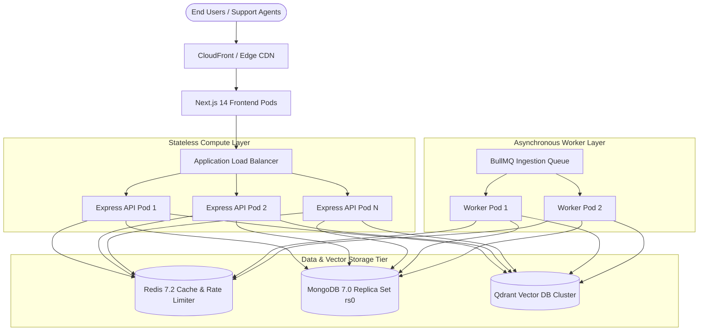

# Enterprise AI Knowledge & Support Copilot — Scalability & Performance Architecture

> **Document Type:** Production Scalability Specification & Engineering Guide  
> **Status:** Active Operational Reference  
> **Location:** `docs/scalability-performance.md`

---

## 1. Architectural Scaling Model

The Enterprise AI Knowledge & Support Copilot is architected as a **stateless, decoupled micro-monolith** designed to scale horizontally across API instances and asynchronous ingestion workers while delegating state to managed databases.

---

## 2. Horizontal Scaling & Stateless Compute

### 2.1. Stateless Express REST API
- **Session Decoupling:** API instances maintain zero in-memory session state. User claims are packaged inside cryptographically signed HMAC-SHA256 JWT access tokens.
- **Session Revocation via Database & Redis:** Targeted session terminations check `tokenVersion` or revocations in MongoDB with Redis caching, enabling instant multi-pod logout without sticky sessions.
- **Auto-Scaling Policy (Target Benchmark):**
  - Horizontal Pod Autoscaler (HPA) configured to scale between `2` and `10` pods.
  - Scale-up trigger: Average CPU utilization $>70\%$ or average HTTP request latency $>800\text{ ms}$ sustained for 60 seconds.

### 2.2. Next.js 14 Frontend Pods
- **Static Assets & App Router:** UI components, icons, and static layouts are pre-rendered at build time.
- **Edge Caching:** Static bundles and CSS assets are served via CDN edge caches with long-lived `Cache-Control: public, max-age=31536000, immutable` headers.
- **Reverse Proxying:** In production, frontend pods serve HTML and forward `/api/*` traffic directly to the Express backend via ingress rules.

---

## 3. Storage & Database Scaling Strategies

### 3.1. MongoDB 7.0 Replica Set (`rs0`)
- **Active Configuration (Verified in Code):** In [`db.ts`](file:///c:/Users/Programming.com/Desktop/Sharad/enterprise-ai/apps/backend/src/config/db.ts), the database connection enforces `serverSelectionTimeoutMS: 5000` and `autoIndex: true`. Connection pooling defaults to Node.js MongoDB driver behavior (default `maxPoolSize: 100`) unless overridden via `MONGODB_URI` connection string options.
- **Recommended Connection Pool Tuning (Proposed Operational Sizing):** In scaled multi-pod production, configure `maxPoolSize: 50` and `minPoolSize: 10` via connection string parameters (e.g., `mongodb://...?maxPoolSize=50&minPoolSize=10`). For 6 backend pods, peak connections are thus bounded at 300, well below MongoDB's connection ceiling.
- **Read/Write Separation (Recommended Roadmap):**
  - Critical writes (user registration, document status transitions, audit log chaining) use write concern `w: "majority"`.
  - Read-heavy administrative analytics and document directories can leverage secondary replica nodes via `readPreference: "secondaryPreferred"`.
- **Indexing Strategy (Verified in Code):** Every collection query is backed by an index. High-frequency queries (such as message history retrieval or document hash checks) utilize compound indexes, eliminating unindexed collection scans (`COLLSCAN`).

### 3.2. Qdrant Vector Database Scaling
- **Dense Vector Search:** Embeddings (768-dimensional for Gemini, 1536-dimensional for OpenAI) are indexed using Hierarchical Navigable Small World (HNSW) graphs.
- **Payload Indexing:** Fields used in pre-retrieval ACL filtering (`is_active`, `minimum_clearance_level`, `allowed_roles`, `allowed_departments`, `allowed_user_ids`) have explicit payload schema indexes in Qdrant.
- **Clustering & Sharding:**
  - In high-throughput deployments, Qdrant collections are partitioned into multiple shards distributed across nodes.
  - Read replication factor set to $2$ or $3$ to scale search query throughput linearly with pod count.

### 3.3. Redis Caching & Invalidation
- **RAG Response Cache (`RagCacheService`):**
  - Cache key incorporates: query text hash, user security clearance rank, department, and a global generation counter.
  - Avoids redundant vector searches and LLM calls for popular organizational questions.
- **Atomic Generation Invalidation:**
  - Whenever a document is created, updated, or deleted, `RagCacheService.invalidateAll()` increments the generation counter via an atomic Redis Lua script (`INCR rag:cache:generation`).
  - Stale cache keys expire naturally via Redis TTL without requiring expensive wildcard key scans (`KEYS *`).

---

## 4. Background Ingestion & Queue Backpressure

- **Decoupled Processing:** Heavy PDF parsing, OCR, and vectorization are offloaded to BullMQ background workers, isolating HTTP API response latency from ingestion load.
- **Queue Backpressure Controls:**
  - Upload file size is strictly capped at `50 MB` (`MAX_FILE_SIZE_BYTES`).
  - Worker concurrency is configured per worker process (default: `1` to `2` concurrent jobs per worker) to prevent CPU starvation during PDF text parsing.
  - BullMQ exponential backoff prevents API worker thrashing during external embedding outages.

---

## 5. LLM Quota, Latency & Cost Optimization

### Cost & Latency Model (Assumptions & Engineering Estimates)

> *Note: These figures represent architectural model estimates based on standard Gemini 1.5 Pro and Flash API pricing and typical enterprise knowledge queries. They are not measured live benchmarks.*

- **Average Query Profile:**
  - User query: ~30 tokens.
  - Retrieved context: 4 chunks $\times$ 350 tokens $\approx$ 1,400 tokens.
  - Generated answer: ~250 tokens.
  - Total tokens per turn: $\approx 1,680$ tokens.
- **Latency Optimization Techniques:**
  - Temperature set to `0.2` for concise, deterministic factual answers.
  - Token ceiling capped at `1024` tokens to prevent runaway generation.
  - Server-Sent Events (SSE) streaming emits the first token in $\sim 400\text{--}800\text{ ms}$, drastically reducing perceived wait time compared to buffered HTTP JSON responses ($3\text{--}5\text{ s}$).
- **Cache Hit Savings:** A modest $25\%$ Redis cache hit rate across repetitive organizational questions saves $\sim 125,000$ LLM calls per 500,000 daily requests.

---

## 6. Rate Limiting & Abuse Prevention

- **Dual-Dimensional Sliding Window:**
  - Implemented in Redis via `RateLimiterService`.
  - **User Quota:** 30 requests / minute (prevents automated script loops).
  - **IP Quota:** 150 requests / minute per IP (prevents multi-account IP spamming).
- **Graceful Failure:** If Redis becomes temporarily unreachable, rate limiters fail open with warning logs, prioritizing business continuity over rate limiting.

---

## 7. Scaling Roadmap: 10,000 to 500,000 Requests / Day

The following staged scaling roadmap outlines necessary infrastructure adjustments as request volume expands by $50\times$:

| Metric / Component | Phase A: 10,000 Req / Day | Phase B: 100,000 Req / Day | Phase C: 500,000 Req / Day |
| :--- | :--- | :--- | :--- |
| **Average Load** | $\sim 0.12\text{ req/sec}$ | $\sim 1.15\text{ req/sec}$ | $\sim 5.8\text{ req/sec}$ |
| **Peak Load (Hour)** | $2\text{--}5\text{ req/sec}$ | $15\text{--}25\text{ req/sec}$ | $50\text{--}80\text{ req/sec}$ |
| **API Compute** | 2 Express pods (0.5 vCPU, 1 GB RAM) | 4 Express pods (1 vCPU, 2 GB RAM) | 8–12 Express pods (2 vCPU, 4 GB RAM) |
| **Worker Compute** | 1 Worker pod | 2 Worker pods | 4 Worker pods |
| **MongoDB Tier** | Single replica set node (rs0) | 3-node Replica Set (Primary + 2 Sec) | 3-node Replica Set (M30/M40 tier) |
| **Redis Tier** | Single standalone instance (0.5 GB) | Master-Replica with Sentinel (2 GB) | Redis Cluster with AOF (4 GB) |
| **Qdrant Tier** | Single container | 2-node cluster with replication | 3-node cluster with sharding |
| **LLM Tier** | Standard Tier API quota | Tier 2 / Committed throughput quota | Enterprise Tier committed TPM quota |
| **Monitoring** | File-based Winston logs | Centralized Loki / Datadog logging | OpenTelemetry tracing + Prometheus |
